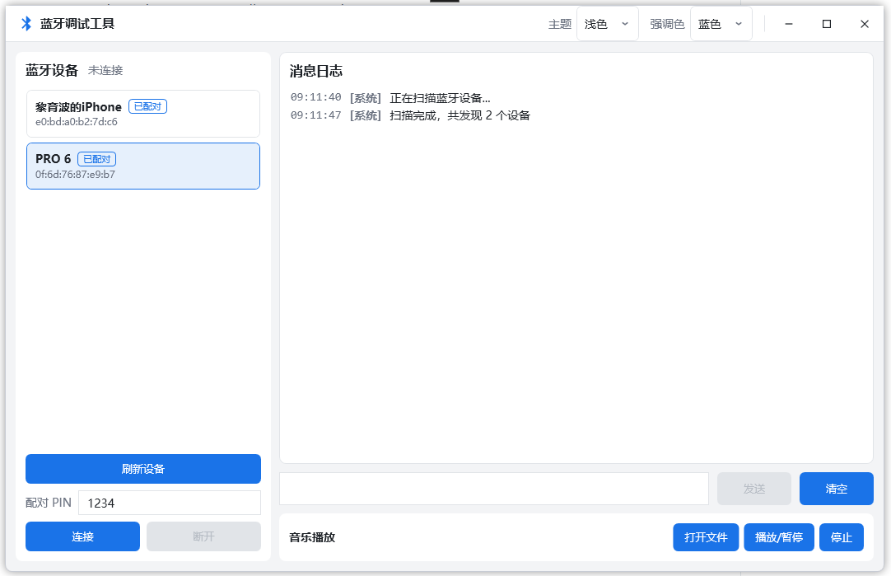

# Bluetooth Debug Tool (BluetoothTool)

A Windows desktop Bluetooth debugging tool built with **C# + WPF + MVVM**. It uses the Windows Classic Bluetooth (RFCOMM/SPP) protocol to provide device scanning, automatic pairing, connection management, message sending/receiving, log viewing and music playback.

## Features

- Bluetooth device scanning: automatically discovers nearby Classic Bluetooth devices and marks the paired status
- Automatic pairing: pairs unpaired devices using a PIN code (default `1234`)
- Connection management: connect / disconnect devices with real-time status
- Messaging: sends and receives UTF-8 text messages over the SPP serial service, with Enter-to-send shortcut
- Message log: distinguishes Sent / Received / System entries, auto-scrolls, keeps up to 500 entries
- Music playback: loads and plays local audio files (mp3 / wav / wma / m4a)
- Multiple themes: light / dark themes with blue / green / purple / orange accent colors
- Custom window: borderless rounded window with shadow, icon, drag, resize, minimize / maximize / close

## Screenshot



## Tech Stack

| Category | Technology |
| --- | --- |
| Runtime | .NET 8 (`net8.0-windows10.0.19041.0`) |
| UI framework | WPF |
| Architecture | MVVM |
| MVVM framework | CommunityToolkit.Mvvm 8.2.2 |
| Behaviors | Microsoft.Xaml.Behaviors.Wpf 1.1.77 |
| Bluetooth | Windows.Devices.Bluetooth / Rfcomm (WinRT) |
| Networking | Windows.Networking.Sockets (StreamSocket) |

## Architecture

The project follows a layered MVVM architecture with separated responsibilities across the view, view model, service and model layers:

- **View (Views)**: XAML UI and window interaction logic
- **ViewModel (ViewModels)**: UI state and commands, driving the view via data binding
- **Service (Services)**: concrete implementations for Bluetooth, audio and theming
- **Model (Models)**: entities and enums
- **Themes**: theme and accent color resource dictionaries
- **Behaviors**: reusable UI behaviors (e.g. log auto-scroll)

## Project Structure

```text
BluetoothTool/
├── App.xaml / App.xaml.cs        # Application entry and service wiring
├── BluetoothTool.csproj          # Project file
├── Assets/
│   └── app.ico                   # Application icon
├── Behaviors/
│   └── AutoScrollBehavior.cs     # Log list auto-scroll
├── Models/
│   ├── BluetoothDeviceInfo.cs    # Bluetooth device entity
│   ├── BluetoothMessage.cs       # Message entity
│   └── ThemeEnums.cs             # Theme and accent color enums
├── Services/
│   ├── BluetoothService.cs       # Bluetooth connection and messaging
│   ├── AudioService.cs           # Audio playback
│   ├── ThemeService.cs           # Theme switching
│   └── I*Service.cs              # Corresponding interfaces
├── Themes/
│   ├── LightTheme.xaml           # Light theme
│   ├── DarkTheme.xaml            # Dark theme
│   ├── Accent*.xaml              # Accent colors
│   └── Controls.xaml             # Global control styles
├── ViewModels/
│   └── MainViewModel.cs          # Main view model
└── Views/
    ├── MainWindow.xaml           # Main window view
    └── MainWindow.xaml.cs        # Window code-behind
```

## Requirements

- Windows 10 (version 2004 / Build 19041) or later
- .NET 8 SDK
- A host with a Bluetooth adapter and a Classic Bluetooth device in discoverable / pairable state

## Installation & Running

```bash
# Restore dependencies and build
dotnet build BluetoothTool.csproj -c Release

# Run
dotnet run --project BluetoothTool.csproj
```

You can also open the solution in Visual Studio 2022 and run it directly.

## Usage

1. The app scans for Bluetooth devices on startup; click "Refresh" to rescan
2. Select a target device in the left list and adjust the pairing PIN if needed (default `1234`)
3. Click "Connect"; the app will pair and establish an SPP connection automatically
4. Type a message and press Enter or click "Send"; received messages appear in the log area
5. Click "Clear" to clear the log
6. In the music area, choose a local audio file and use Play/Pause / Stop
7. Switch theme and accent color in the top-right corner

## Bluetooth Connection Flow

1. Scan nearby Classic Bluetooth devices using `BluetoothDevice.GetDeviceSelector()` + `DeviceWatcher`
2. Pair unpaired devices via `DeviceInformationCustomPairing` + `DevicePairingKinds.ProvidePin`
3. Enumerate RFCOMM services with `GetRfcommServicesAsync(BluetoothCacheMode.Uncached)` and pick the serial (SPP) service
4. Establish the SPP connection via `StreamSocket.ConnectAsync`
5. Send/receive UTF-8 data via `DataWriter` / `DataReader`, with a cancellable receive loop

## FAQ

- **No devices found**: make sure the host Bluetooth is on, the target device is powered and discoverable/pairable, or pair it in Windows Bluetooth settings first and rescan
- **Connection failed (COMException)**: verify the device supports the SPP serial service and the PIN is correct; try pairing manually in Windows Bluetooth settings first
- **Exception on disconnect**: resources are cleaned up gracefully after a broken connection and do not affect subsequent reconnects

## Contribution

1. Fork the repository
2. Create a `Feat_xxx` branch
3. Commit your code
4. Create a Pull Request
