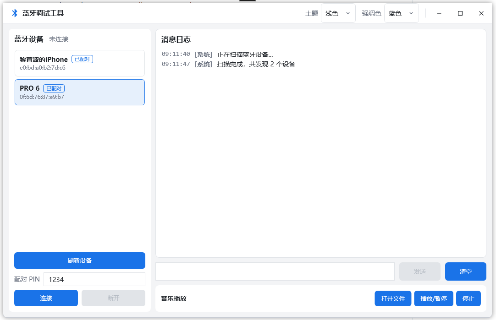

# 蓝牙调试工具（BluetoothTool）

基于 **C# + WPF + MVVM** 的 Windows 桌面蓝牙调试工具，使用 Windows 经典蓝牙（RFCOMM/SPP）协议，支持设备扫描、自动配对、连接管理、消息收发、日志查看与音乐播放。

## 功能特性

- 蓝牙设备扫描：自动发现附近经典蓝牙设备，并标识已配对状态
- 自动配对：未配对设备使用 PIN 码（默认 `1234`）自动完成配对
- 连接管理：连接 / 断开蓝牙设备，状态实时显示
- 消息收发：通过 SPP 串口服务收发 UTF-8 文本消息，支持回车快捷发送
- 消息日志：区分「发送 / 接收 / 系统」三类日志，自动滚动，最多保留 500 条
- 音乐播放：加载并播放本地音频（mp3 / wav / wma / m4a）
- 多主题：浅色 / 深色主题，蓝 / 绿 / 紫 / 橙四种强调色实时切换
- 自定义窗口：无边框圆角窗口，支持阴影、图标、拖动、缩放、最小化 / 最大化 / 关闭

## 软件截图



## 技术栈

| 类别 | 技术 |
| --- | --- |
| 运行时 | .NET 8（`net8.0-windows10.0.19041.0`） |
| UI 框架 | WPF |
| 架构 | MVVM |
| MVVM 框架 | CommunityToolkit.Mvvm 8.2.2 |
| 行为 | Microsoft.Xaml.Behaviors.Wpf 1.1.77 |
| 蓝牙 | Windows.Devices.Bluetooth / Rfcomm（WinRT） |
| 网络 | Windows.Networking.Sockets（StreamSocket） |

## 软件架构

项目采用分层 MVVM 架构，视图层、视图模型层、服务层与实体层职责分离：

- **View（Views）**：XAML 界面与窗口交互逻辑
- **ViewModel（ViewModels）**：界面状态与命令，通过数据绑定驱动视图
- **Service（Services）**：蓝牙、音频、主题等具体业务实现
- **Model（Models）**：实体与枚举定义
- **Themes**：主题与强调色资源字典
- **Behaviors**：可复用的界面行为（如日志自动滚动）

## 项目结构

```text
BluetoothTool/
├── App.xaml / App.xaml.cs        # 应用入口与服务装配
├── BluetoothTool.csproj          # 项目文件
├── Assets/
│   └── app.ico                   # 应用图标
├── Behaviors/
│   └── AutoScrollBehavior.cs     # 日志列表自动滚动
├── Models/
│   ├── BluetoothDeviceInfo.cs    # 蓝牙设备实体
│   ├── BluetoothMessage.cs       # 消息实体
│   └── ThemeEnums.cs             # 主题与强调色枚举
├── Services/
│   ├── BluetoothService.cs       # 蓝牙连接与收发实现
│   ├── AudioService.cs           # 音频播放实现
│   ├── ThemeService.cs           # 主题切换实现
│   └── I*Service.cs              # 对应接口
├── Themes/
│   ├── LightTheme.xaml           # 浅色主题
│   ├── DarkTheme.xaml            # 深色主题
│   ├── Accent*.xaml              # 强调色
│   └── Controls.xaml             # 全局控件样式
├── ViewModels/
│   └── MainViewModel.cs          # 主视图模型
└── Views/
    ├── MainWindow.xaml           # 主窗口视图
    └── MainWindow.xaml.cs        # 窗口代码后置
```

## 环境要求

- Windows 10（版本 2004 / Build 19041）及以上
- .NET 8 SDK
- 具备蓝牙适配器的主机，以及处于可被发现 / 可配对状态的经典蓝牙设备

## 安装与运行

```bash
# 还原依赖并构建
dotnet build BluetoothTool.csproj -c Release

# 运行
dotnet run --project BluetoothTool.csproj
```

也可使用 Visual Studio 2022 打开解决方案直接运行。

## 使用说明

1. 启动应用后会自动扫描蓝牙设备，也可点击「刷新设备」重新扫描
2. 在左侧列表选择目标设备，必要时修改「配对 PIN」（默认 `1234`）
3. 点击「连接」，应用会自动完成配对并建立 SPP 连接
4. 在输入框输入消息，按回车或点击「发送」；收到的消息会显示在日志区
5. 点击「清空」可清空日志
6. 在「音乐播放」区选择本地音频文件，点击「播放/暂停」「停止」进行控制
7. 在窗口右上角切换「主题」与「强调色」

## 蓝牙连接原理

1. 使用 `BluetoothDevice.GetDeviceSelector()` + `DeviceWatcher` 扫描附近经典蓝牙设备
2. 对未配对设备，通过 `DeviceInformationCustomPairing` + `DevicePairingKinds.ProvidePin` 自动配对
3. 使用 `GetRfcommServicesAsync(BluetoothCacheMode.Uncached)` 枚举设备的 RFCOMM 服务并选择串口（SPP）服务
4. 通过 `StreamSocket.ConnectAsync` 建立 SPP 连接
5. 使用 `DataWriter` / `DataReader` 以 UTF-8 编码收发数据，读取循环支持可取消退出

## 常见问题

- **扫描不到设备**：请确认主机蓝牙已开启、目标设备已通电并处于可被发现 / 可配对状态，或先在 Windows 蓝牙设置中完成配对后重新扫描
- **连接失败（COMException）**：请确认设备支持 SPP 串口服务，且 PIN 码正确；可尝试在系统蓝牙设置中先手动配对后重试
- **断开时提示异常**：连接中断后资源已做容错清理，不影响后续重新连接

## 参与贡献

1. Fork 本仓库
2. 新建 `Feat_xxx` 分支
3. 提交代码
4. 新建 Pull Request
